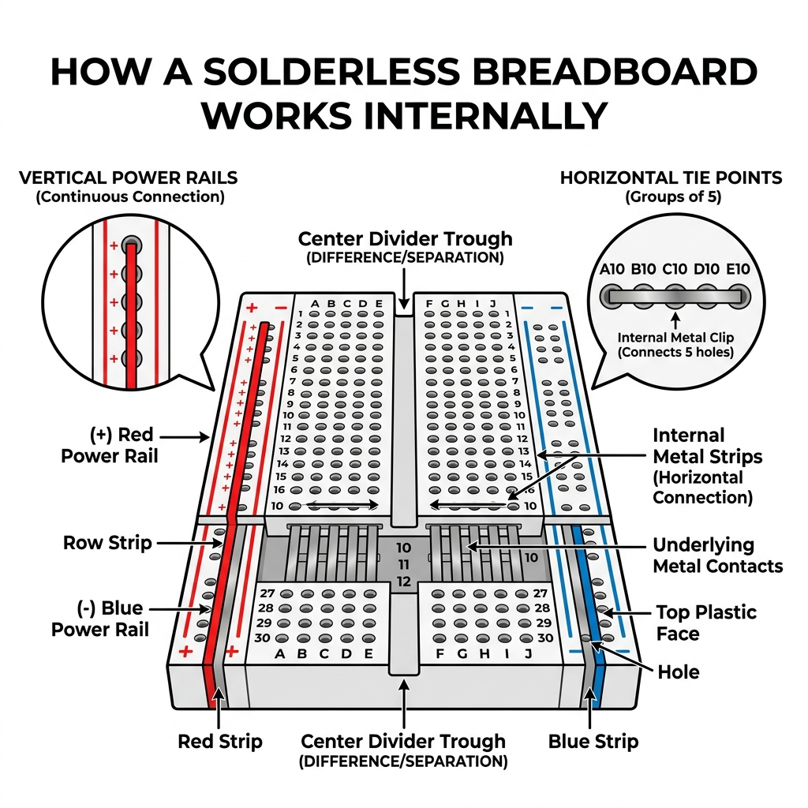
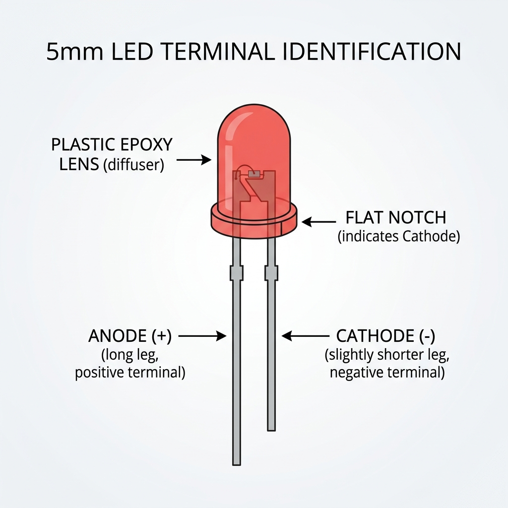
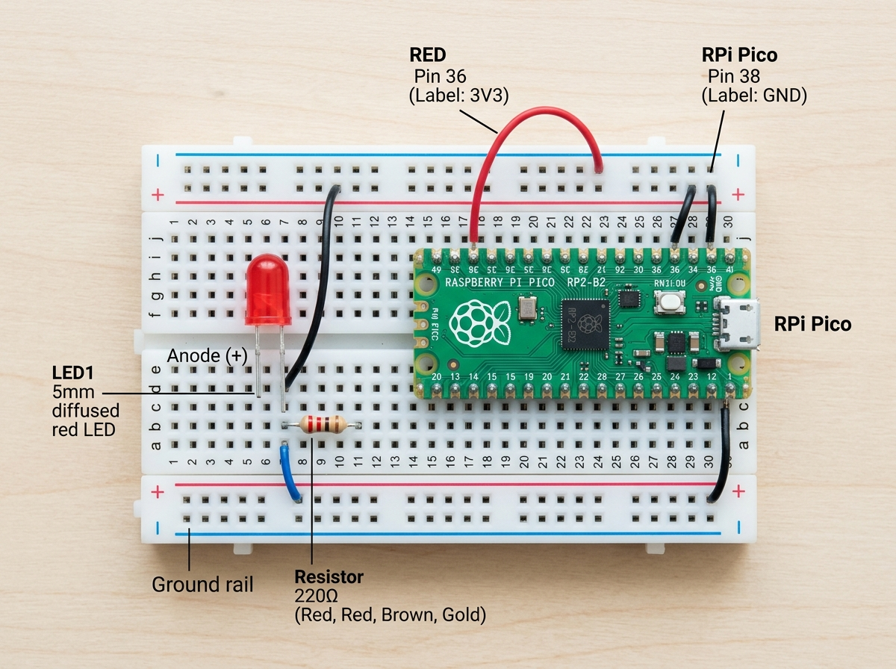

# Beginner's Guide: First LED Test with Phone Camera

If you have never touched electronics or a breadboard before, don't worry! This guide breaks down every single component, shows you how the breadboard works, and walks you through the exact holes to plug things into.

---

## 1. How a Breadboard Works

A breadboard lets you connect wires and electronic parts together **without any soldering**. Inside the plastic are small metal spring clips that grip the component legs.

### The 3 Rules of Breadboards:
1. **The Numbered Rows (Horizontal):**
   * Look at the center area marked with numbers **1 to 30** and letters **a, b, c, d, e** on the left, and **f, g, h, i, j** on the right.
   * Holes in the same row of 5 (e.g., `1a, 1b, 1c, 1d, 1e`) are **connected to each other underneath**. Plugging two wires into the same row connects them together.
2. **The Center Trough (The Ditch):**
   * The trench down the middle separates the left side (`a-e`) from the right side (`f-j`). Row `1a-1e` does **NOT** connect to row `1f-1j`.
3. **The Outer Power Rails (Vertical):**
   * The long columns on the outer edges with the red (`+`) line and blue (`-`) line run **vertically up and down**. You use the blue rail for Ground (`GND`).

> [!CAUTION]
> **Never connect both legs of the same part into the same 5-hole row.** That creates a "short circuit" where electricity bypasses the component completely.

---

## 2. Component Identification

### A. The 850nm IR LED
An LED is a "one-way street" for electricity. It only lights up if plugged in the right direction.

* **Long Leg = Anode (+)** $\rightarrow$ Connects toward positive power (3.3V).
* **Short Leg = Cathode (-)** $\rightarrow$ Connects toward Ground (`GND`). Look closely at the round plastic rim: the short leg side also has a small **flat notch**.

---

### B. The $100\,\Omega$ Resistor
Resistors control the flow of electricity so the LED doesn't burn out.

* **Identification:** Find the small beige or blue cylinder with colored bands from the resistor kit.
* **Color Bands:** **Brown - Black - Brown - Gold** (4-band) or **Brown - Black - Black - Black** (5-band).
* **Direction:** Resistors do **not** have a positive or negative side. They work in either direction!

---

### C. The Raspberry Pi Pico H

* Look at the green board. The silver USB connector is at one end.
* Flip it so you can see the small text printed next to the pins:
  * **`3V3` (Pin 36):** Provides 3.3 Volts of safe, steady DC power.
  * **`GND` (Pin 38 or Pin 3):** Ground (0 Volts), completes the electrical loop.

---

## 3. Circuit Wiring Overview

Here is an illustrated visual showing how the Pico, resistor, and LED sit on the breadboard:

---

## 4. Step-by-Step Assembly (Follow Line-by-Line)

### Step 1: Place the Pico on the Breadboard
1. Hold the Raspberry Pi Pico H with its header pins pointing down.
2. Position it so the **micro-USB port points off the end of the breadboard**.
3. Press it down firmly across the **center trough** into **columns `c` and `h`** (the Pico is 0.7" wide, so column `c` on the left and column `h` on the right gives a perfect fit with free tie holes on both sides: `a, b, d, e` and `f, g, i, j`). Press until the black plastic headers sit snug against the breadboard.

---

### Step 2: Plug in the Resistor
1. Take your **$100\,\Omega$ resistor**.
2. Gently bend both metal wire legs at a 90-degree angle so it looks like a staple.
3. Plug **one leg** into the row directly next to the Pico's **`3V3` pin** (Pin 36, near the top right of the Pico).
4. Plug the **other leg** into any empty row a few holes away (for example, **Row 8**).

---

### Step 3: Plug in the 850nm IR LED
1. Take the **850nm IR LED**. Identify the **long leg (+)** and **short leg (-)**.
2. Plug the **Long Leg (+)** into the **same row as the resistor** (Row 8). Now electricity flows from 3.3V $\rightarrow$ through resistor $\rightarrow$ into LED long leg!
3. Plug the **Short Leg (-)** into the next empty row (for example, **Row 9**).

---

### Step 4: Complete the Loop to Ground
1. Take one jumper wire (male-to-male).
2. Plug one end of the wire into **Row 9** (the same row where the LED's short leg is).
3. Plug the other end of the wire into the row directly next to any **`GND` pin** on the Pico (Pin 38 is right next to Pin 36!).

---

### Step 5: Power Up and Test with Phone Camera
1. Plug the micro-USB cable into the Pico and connect the other end to your laptop or USB phone charger. The Pico is now powered.
2. **Open your phone's camera app.**
3. **Switch to your front-facing (selfie) camera.**
   > [!NOTE]
   > Why the selfie camera? Rear smartphone cameras have an aggressive infrared filter that blocks IR light. The front selfie camera does not filter it out, allowing you to see infrared light clearly.
4. Point the selfie camera directly at the clear top dome of the LED.
5. **Look on your phone's screen:** You should see a glowing **bright purple or pale violet-magenta light** shining from the center of the LED!
